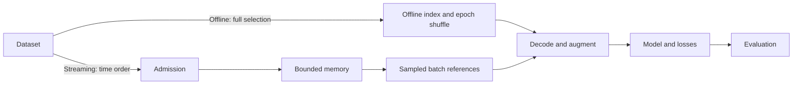

# Architecture

EgoLearn separates the data a learner has seen from the data it trains on in
each update. Streaming methods can then differ in what they remember and how
they sample it, while sharing models, augmentation, optimization and evaluation.
This page explains how a run fits together, for readers who write configs or
add a method.

## Training flow

A streaming learner reads observations in time order and keeps a bounded subset
for training. Its memory works like a reading list. An entry says which frames to
revisit, and the frames themselves stay in the dataset.

Each cycle advances the stream, admits completed items to memory and runs a set
number of updates. For each update, a batch recipe samples entries from memory
and the loader decodes and augments their frames. Offline training replaces the
stream and memory with the whole dataset, shuffled every epoch, and shares
everything else. A fair comparison between the modes still needs matched data,
objectives and compute.

Configs select each component by its registered name, such as
`encoder:resnext50`, and a config's `_imports_` list adds a method's own
components. Every method therefore uses the same `egl train` entry point.

## Streams

A stream presents a dataset as ordered sessions, usually one per recording, with
channels such as video and text aligned by media time. Frame directories, packed
frame stores and video files share this interface. An utterance becomes visible
at its end time, so the learner never trains on words it has not yet heard.

## Memory

Admission turns observations into memory items, such as single frames or
BabyCL's segments and utterance–frame pairs. Memory stores references to frames
rather than decoded images, so capacity does not depend on image resolution and
each replay draws fresh augmentations.

A memory has one or more tiers, each with a capacity, a sampling policy and an
update policy such as FIFO or reservoir sampling. Items can enter several tiers
directly, or spill from one tier into the next when it evicts them.

Labels live in a label store and are looked up when a batch is assembled. A
method can therefore revise labels, as Memory Storyboard does after
reclustering, without rewriting its buffers or coordinating the loader processes.

## Batches

A batch recipe lists slots. Each slot names its source (a tier, a mix of tiers
or the newest items), the number and unit of its items, the augmentation views
and any labels. A fallback recipe covers shortages, such as BabyCL's visual-only
batches before enough utterance pairs exist.

## Models and losses

A model is a set of named encoders, heads and predictors chosen in the config.
Slots reach encoders by modality, so each modality has at most one trainable
encoder, and extra copies such as an exponential-average target are frozen.
Each loss names the slots and model parts it reads, so several objectives can
share one representation. A checkpoint stores the model's construction metadata,
which lets evaluation rebuild the model without the training pipeline.

## Evaluation

A benchmark scores a saved model independently of training, and small benchmarks
also run as probes during training with the same scoring code. Each benchmark
declares the representations it needs, which the evaluator checks before it
starts. The [evaluation guide](../evaluation.md) lists the benchmarks.

## Training and concurrency

A stream advance is the new data the learner reads between rounds of updates,
counted in observations or in completed items. After each advance, the driver
runs a set number of updates, and each one draws a fresh batch or reuses the last.

Streaming decisions stay in order, while worker processes decode and augment
frames in parallel. Prefetch prepares the next batch only within the current
advance, so it never uses memory that a later advance would change. Seeds for
each batch and item come from the run's seed, so samples and augmentations do
not depend on the number of workers. The training loops do not implement
distributed data-parallel training. To resume a streaming run, the driver
replays the consumed observations to rebuild its admission state, then restores
the saved memory.

## Method differences

Memory Storyboard segments with the model it is training, so its segments change
as the model improves, and its labels must be revisable. BabyCL's frozen
segmenter finalizes a segment once later frames cannot change it, so each label
is written once. Its supervised contrastive objective treats frames that share
a global segment ID as positives.

| Choice | Memory Storyboard | BabyCL |
| --- | --- | --- |
| Memory unit | Frames | Visual segments and utterance–frame pairs |
| Tier routing | Independent admission to short and long tiers | Short-tier overflow into the long tier |
| Segmentation features | Learner's current backbone | Frozen ImageNet ResNeXt-50 |
| Segment labels | Revisable global classes | Global segment IDs, shared by merged segments |
| Repeated updates | Reuse the batch | Resample each batch |
| Objectives | Instance discrimination and segment supervised contrastive learning | The same, plus image–text contrastive learning |

## Extension points

New methods go under `src/egolearn/methods/<name>/` and their configs under
`projects/<name>/`, as the [project conventions](../../projects/README.md)
describe.

| Extension | Starting point |
| --- | --- |
| Dataset adapter | [Stream and channel interfaces](../../src/egolearn/data/sources/base.py) |
| Admission algorithm | [Event builder interfaces](../../src/egolearn/memory/admission/base.py) |
| Memory retention | [Update policies](../../src/egolearn/memory/update.py) |
| Encoder | [Encoder interface](../../src/egolearn/model/encoders/base.py) |
| Objective | [Loss interface](../../src/egolearn/model/losses/base.py) |
| Augmentation | [Registered views](../../src/egolearn/data/views.py) |
| Training loop | [Streaming driver](../../src/egolearn/training/driver.py) |
| Evaluation | [Adding benchmarks](../evaluation/extending.md) |
