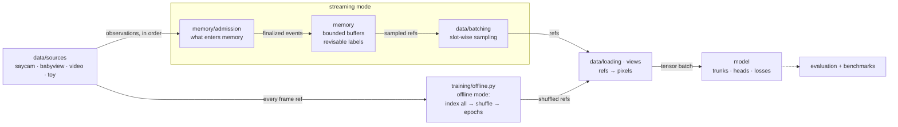

# Architecture

How the streaming framework fits together. Install and quickstart live in the
[README](../../README.md); design contracts that predate this implementation
are in [streaming.md](streaming.md).

The setting: a learner watches a long video stream exactly once, in
chronological order. It has to decide what to keep in a bounded memory, how
to build training batches out of that memory, and how much compute to spend
per unit of new data, and it gets evaluated continuously while it learns.

A method here is a config file. It picks components from the shared toolbox,
plus whatever novel algorithms it contributes itself. Two reproductions ship
with the framework and were used to pressure-test the design:

* **Memory Storyboard** — streaming visual SSL with temporal segmentation
  and a two-tier memory (`src/egolearn/methods/storyboard/`)
* **BabyCL / BabyCLIP** — continual visual+verbal learning from SAYCam in a
  single chronological pass (`src/egolearn/methods/babycl/`)

Both are plain configs over the toolbox; their segmentation algorithms are
1:1 ports of the original published code.

Conventional offline IID training is also supported, as a parallel mode
rather than an afterthought: `driver.mode: offline` gives you the ordinary
shuffle-and-epochs loop with no memory machinery at all. It exists because
it's the upper bound every streaming method gets compared against.

## How it fits together



Not drawn: `training/driver.py` turns the streaming crank (advance the
stream, admit, run k rate-limited gradient steps, repeat), and the solver,
hooks and stage timer sit beside both loops. Method-owned research code (the
segmenters) registers into the same admission slot as the built-in
components.

One streaming cycle, concretely. The driver pulls the next observations in
time order — a frame, or an utterance that just finished. At this point
everything is references and metadata; no pixels. Admission components watch
the stream and emit units that are final and will never change (a frame, a
~3-minute segment, an utterance–frame pair). Events get routed into memory
tables by schema; when a table is full, its update policy decides who stays.
To train, the composer follows the batch recipe and samples references from
memory ("3 segments × 32 frames + 32 utterance–frame pairs, 25% short / 75%
long"), and only then does the Loader decode and augment anything. Each loss
reads model features through named taps/heads, the weighted sum
backpropagates, and after k gradient steps the driver goes back to the
stream. The run ends when the stream is exhausted — never at a precomputed
step count. Probes can score the model at any point along the way.

Offline mode skips all of that: list every frame up front (still just
references), shuffle once per epoch, draw batches, decode, train. The two
modes share the loader, augmentations, model, losses, solver and evaluation,
so a streaming-vs-IID comparison isolates the training regime rather than
accidental implementation differences.

Where code goes:

| Home | Rule of thumb | Contents |
|---|---|---|
| `src/egolearn/` | anything installable and tested | the five modules, plus `methods/<name>/` (one paper's novel components) and `evaluation/benchmarks/` (scoring, belongs to no method) |
| `projects/<name>/` | what you type to run a paper | configs composing on the packaged tree; thin entry points |
| `scripts/` | operations | Slurm launchers, benchmarks |

A config lists `_imports_:`; importing a methods module registers its
components. If a component turns into a de-facto standard it gets promoted
out of `methods/` without changing its config-facing name. The acceptance
test we hold ourselves to: a method should be fully expressed by its config
plus its own `methods/` package. If a method has to patch the toolbox, some
protocol is missing a piece.

## Core vocabulary

Three small types from `src/egolearn/core/` show up everywhere:

* `ItemRef` — a reference to a time interval on one channel of one session:
  `(session, channel, t0, t1, locator)`. A single frame is the point
  interval `t1 == t0`. Refs are cheap and immutable; pixels are decoded as
  late as possible, only inside the Loader. Whether a ref loads as one
  frame, K sampled frames, or a contiguous clip is the batch recipe's
  decision, not the ref's.
* sample record — a plain dict whose keys are registered names (`time.t0`,
  `video.ref`, `text.utterance`, `weight.sample`, ...). A typo'd key fails
  loudly at first use. Components pass through keys they don't know, which
  is how e.g. a per-sample importance weight travels untouched from the
  dataset json to the loss.
* event — a named schema (a required key set) for records entering memory:
  `RawFrame`, `VisualSegment`, `AlignedPair`. `build()` checks all of these
  contracts at construction time.

## The modules

### `egolearn.data`

`sources/` holds dataset adapters. A `Stream` is an ordered set of sessions;
a session exposes time-aligned channels, dense (video frames) and sparse
(utterances, narrations, annotations). Sparse items are surfaced at their
end time — a streaming learner never acts on an utterance it hasn't fully
heard. Alignment is always media time, never index. Ships with
`stream:saycam`, `stream:babyview`, `stream:video` and `stream:toy`
(synthetic, with known ground truth).

`decoding/` is where video decode backends live. Baseline storage is
pre-extracted frames (`decoder:frame_dir`), per streaming.md; the
`VideoDecoder` protocol keeps the door open for on-the-fly decoding, with
sequential access (the streaming pass: open handle, read ahead) and random
access (replay: seek to keyframe, decode one window) as separately
optimizable paths. `decoder:poodle` is the stub for the lab's efficient
video pipeline; its docstring lists what the integration has to provide.

`loading.py` is the Loader, the only place refs become tensors. It serves
every data unit — single frames, K frames sampled from a segment, pairs, and
contiguous clips — and records its time under `data.load` in the stage
ledger. `views.py` holds named augmentation pipelines (`center_crop`,
`simclr_strong`; method-tied recipes like `cvcl_aug` live in their methods
package) plus clip-domain views that draw parameters once per clip so all T
frames get the same crop/flip/jitter.

`batching/` declares what a minibatch is. A recipe is a list of slots; each
slot names its source (a memory tier, a tier mix with fractions, or the
newest events), a unit (`frame`, `segment`, `pair`, `clip`), views, and
where labels come from. A recipe may carry a fallback — BabyCL uses this
when the multimodal slot is starved early in the stream and the batch
becomes all-visual. The composer draws every slot's refs before decoding a
single pixel (a starved strict slot must not waste the other slots' decode
work), then loads and collates. How a unit is *consumed* (which trunk, which
loss) is the model side's business; the loading layer just has to support
the shape.

### `egolearn.memory`

Streaming-mode machinery, all of it. `table.py` has `Table` (capacity,
update policy, sampler; holds records with refs, never tensors) and
`TieredMemory`, supporting the two topologies the reproductions needed:
spill (new items enter short; FIFO overflow drains into a long reservoir —
BabyCL) and parallel (new items enter short and long independently — Memory
Storyboard). `update.py` has the standard update policies (`fifo`,
`reservoir`, `reservoir_weighted`, `random_replace`); research policies
belong in methods packages.

`labels.py` is the LabelStore. Stored items don't carry labels — they carry
a key, and labels are resolved through the store at batch time. That way a
label can be revised long after the item entered memory (Memory Storyboard
reclusters and merges classes retroactively; BabyCL merges global ids when
two segments turn out to be the same thing). Stored items are never mutated.

`admission/` defines the `EventBuilder` protocol: online components that
watch the stream and decide what enters memory. Emitters produce finalized
events — emitted once, never changed. Labelers maintain a LabelStore. One
class can play both roles; the segmentation algorithms of both papers are
method-owned builders that do.

### `egolearn.model`

`EgoModel` wraps trunks that expose named taps (`vision.pool2048`,
`text.embed`) and heads that hang off taps (`proj128`, `cls`, `embed512`).
Losses and probes touch the model only through taps and heads, and every
checkpoint carries this contract, so a trained encoder drops into any probe
by tap name. Trunks: `resnext50` (both papers train it from scratch),
`resnet18`, `toy_cnn`. Losses: `ntxent` (accepts several slots and
concatenates — MS computes it over current+replay jointly), `tcl`
(segment-label cross-entropy with optional masking of unseen classes),
`clip_infonce` (symmetric image–text InfoNCE, optional per-sample weights).
A method is which losses, at what weights, over which slots — all config.

### `egolearn.training`

`driver.py` is the streaming loop, kept deliberately small. Advance the
stream by a quantum (a fixed number of observations — MS uses 64 frames — or
until N events of a schema appear — BabyCL waits for 1 finalized segment),
route events to memories, then run `steps_per_admit` gradient steps. With
`resample: true` each step composes a fresh batch (BabyCL's
repeats_per_push); with `false` the same batch is reused (MS's num_grads).
Warmup is an admit-only phase until a buffer tier fills. If a method needs a
different loop, subclass the driver.

`offline.py` is the IID counterpart: index, shuffle per epoch, train.
Declaring memory/admission/recipe sections in an offline config is a
validation error, on purpose.

`solver.py` maps regex-matched parameter groups to (lr, weight decay), with
optional BN/bias decay exemption. The LR schedule runs off the progress
clock — the fraction of the stream consumed — anchored at the first gradient
step, so buffer warmup doesn't eat into the LR warmup. No epochs, no
total-step estimation.

`profiling.py` is the `StageTimer`. Every run measures `stream.advance`,
`data.load`, `batch.compose`, `model.forward`, `model.backward` and
`optim.step`, and prints the ledger, so "how much do the abstractions cost"
is a number rather than an argument. `scripts/bench/` runs the ledger
standalone: `bench_full_pipeline.py` over real training steps,
`bench_dataloading.py` over the data plane alone. For calibration: the
original BabyCL holds roughly 70% GPU utilization on 2×A100, and a port
should be compared against that before merging. Current single-thread
measurements (one L40S, 2026-08): stream ingest runs at ~700× realtime and
is nowhere near the bottleneck; batch composition takes ~1.4 s (about 80% of
it in the ms-view Gaussian blur), capping a single-threaded run at ~0.7
steps/s. The planned fix is to keep the control plane (sampling, RNG draws)
serial and fan the order-free decode+augment work out to a worker pool.

Resume works in both modes: pass `resume=auto` (or a snapshot path) to the
train entry point. A snapshot holds the whole world — model, optimizer,
clocks and RNG states, memory tables, label stores, LR anchor. On restore,
streaming mode replays the already-consumed stream deterministically to
rebuild the admission components' internal state (replayed events don't
touch memory; that comes from the snapshot). Offline mode regenerates the
epoch shuffle from (seed, epoch) and picks up mid-epoch.

### `egolearn.evaluation` and `evaluation/benchmarks/`

A `Probe` is `run(model, ctx) → {metric: value}` and can execute at a
gradient-step cadence during training or on checkpoints after. Each concrete
benchmark owns a package under `src/egolearn/evaluation/benchmarks/`, ported
1:1 from the original eval scripts:

| Benchmark | Protocol | Metric |
|---|---|---|
| `labeled_s_4afc` | target word vs 4 candidate images, argmax cosine | `four_afc_acc` |
| `vtwt` | one image, two 2-word phrases; the positive must strictly win | `vtwt_acc` |
| `baby_winoground` | 2×2 image/phrase matrix; group-correct iff both directions hold | `bw_group_acc` + per-context accs |

Some quirks of the originals are preserved on purpose (OOV words map to
padding index 0 and still count in the mean-pool denominator; no sos/eos;
32-token truncation), since OOV handling is part of what these benchmarks
measure. Linear probing and BabyView object detection are on the roadmap.

### Configs: hydra outside, registries inside

The split of labor: **hydra owns how YAML becomes one config dict** —
defaults lists, `--config-dir`/`--config-name`, CLI overrides
(`seed=42 driver.rate.steps_per_admit=4`), multirun, and writing every run's
resolved config to `.hydra/config.yaml` (the reproduction truth). **The
registries own how that dict becomes objects**: `_target_: "kind:name"`
resolves through per-kind registries (`stream`, `decoder`, `view`,
`admission`, `update`, `sampler`, `embedder`, `trunk`, `head`, `loss`,
`probe`), nested nodes instantiate recursively, `_imports_:` pulls in
methods/benchmark modules.

The registry layer buys three things hydra's bare `_target_` doesn't: short
names decoupled from code location (promoting a component out of `methods/`
changes no config), kind checking (a view pasted into an admission slot
fails with a one-line error), and self-registration of method components on
import. No logic in configs — YAML describes an object graph and scalar
hyperparameters, nothing else.

Project configs compose the packaged tree per the repo convention:

```yaml
defaults:
  - /config          # packaged root: seed, wandb, dry_run, resume
  - _self_
hydra:
  searchpath:
    - pkg://egolearn.configs
```

## Streaming vs offline, side by side

| | `mode: streaming` | `mode: offline` |
|---|---|---|
| loop | advance → admit → rate-limited steps | shuffle → epochs |
| data access | sequential, in order (+ random for replay) | random/shuffled |
| memory / admission | bounded tiers, update policies, event builders | none |
| progress clock | fraction of stream consumed | fraction of planned steps |
| epochs | never | conventional |

See `src/egolearn/configs/offline_iid_saycam.yaml` for an offline example:

```bash
uv run python -m egolearn.train --config-name offline_iid_saycam \
    stream.root_dir=$DATA_ROOT
```

## The two reproductions

`methods/storyboard/` carries Memory Storyboard's contributions:
`greedy_hierarchical_clustering` and `get_cluster_score` verbatim from the
public repo (including the quirk of forcing K−1 cuts even when the score
drops), the recluster-on-window-turnover admission builder with retroactive
relabeling through the LabelStore, and `embedder:learner_tap` (MS segments
with the learner's own backbone).

`methods/babycl/` carries BabyCL's: the segmentation math from
`online_ms_refine.py` verbatim, the OnlineSegmenter (sliding window,
utterance-anchored expansion, ~3-minute packing, watermark finalize-once,
global-id merge with cross-session handover), the multimodal admission path
(raw timestamp runs, atomic complete-visibility emission, dedup — and no
similarity expansion, because the original feeder discards the segmenter's
expanded chunks), the frozen ResNeXt embedder, the bag-of-words text trunk,
and both augmentation recipes (`cvcl_aug` with the original's PIL radius
blur; `babycl_ms_aug`, which fuses the original's two-stage center-crop-then
-strong-SimCLR segment augmentation into one pipeline).

Where the two methods differ is easiest to see side by side:

| Mechanism | Memory Storyboard | BabyCL |
|---|---|---|
| memory unit | frame refs (short admits every 8th) | segment refs + pair refs |
| admission topology | parallel: new → short and long | spill: new → short, overflow → long |
| batch | slot(short)=64 + slot(long)=448 | 3 segs×32 + 32 pairs, tiers split by the `want//4` rule |
| segmentation | recluster window, retroactive relabel | watermark finalize-once, utterance-anchored expansion |
| segmentation embeddings | learner's own backbone | frozen ImageNet ResNeXt |
| labels | global ids, revised on recluster/merge | batch-local for TCL, write-once gids |
| rate limiter | same batch × num_grads (`resample: false`) | fresh batch × 8 (`resample: true`) |
| losses | 1.0·ntxent(curr+replay) + 1.0·tcl(replay) | 0.5·ntxent + 0.5·tcl + 0.5·clip_infonce |

Framework adaptations are documented in each component's docstring; the
algorithms themselves are untouched (ruff exempts the verbatim files so
their original style survives). Published BabyCL ablations are config
diffs — see `projects/babycl/README.md`.

## Design rules

A few rules the codebase follows consistently:

* Refs upstream, pixels downstream. Everything before the Loader manipulates
  references and small metadata; decoding happens at batch time. This is
  what makes on-the-fly video decoding a backend swap, and generative memory
  "a Loader that synthesizes".
* Events are emitted once and never change; labels are revisable through the
  LabelStore. That split is exactly what both published systems need.
* In the streaming loop, time is the only index — progress and step clocks,
  media time inside records, no task ids. The offline loop has conventional
  epochs, which is the point of it being the traditional baseline.
* All randomness is named and seeded (`ctx.rng("memory.pairs.short")`), so
  runs are deterministic regardless of scheduling.
* Every run carries the stage-latency ledger, and merges get validated by
  real experiments. When the ledger shows an abstraction is the bottleneck,
  the fix is a lower-level implementation behind the same protocol (native
  decode, hot paths in C++), not living with it.
* V1 is lockstep, single-process, deterministic. Async ingestion, DDP and
  event-sourced resume are deferred; the interfaces keep those doors open.

## Extending

* New method: a `src/egolearn/methods/<name>/` package (components,
  registered on import) plus a `projects/<name>/` directory (configs, entry
  points).
* New dataset: a source adapter in `src/egolearn/data/sources/`. Ego4D
  narrations are structurally SAYCam utterances, so `an_chunk_emitter`
  transfers unchanged.
* New video backend: implement `VideoDecoder` (the Poodle integration is
  exactly this).
* New modality (audio, gaze, boxes, precomputed embeddings): register its
  keys and put the values in a channel payload; if it needs decoding, add a
  method to the Loader next to `frame_views`; if it must co-transform with
  crops (gaze, boxes), extend the view signature — views already receive the
  whole record for this reason.
* New benchmark: a package under `src/egolearn/evaluation/benchmarks/`
  owning its probe.
* New loop behavior: subclass `LockstepDriver`.

## File guide

Mode column: shared = both training modes, streaming/IID = that mode only,
method = one paper's research code, eval = benchmark code.

| File | Mode | What it is |
|---|---|---|
| `src/egolearn/train.py` | shared | hydra entry point: compose config → `build()` → `validate()` (`dry_run=true` stops here) → optional `resume=` → `fit()` |
| `src/egolearn/pipeline.py` | shared | reads the composed config, builds the streaming or offline pipeline, validates every contract before any data is read |
| `src/egolearn/configs/` | shared | packaged hydra tree: root config (seed, wandb, dry_run, resume) + the offline IID example |
| `src/egolearn/core/keys.py` | shared | the key registry; every dict between modules uses keys registered here, typos fail at first use |
| `src/egolearn/core/refs.py` | shared | `ItemRef` — the reference type the control plane passes around instead of pixels |
| `src/egolearn/core/events.py` | shared | event schemas (`RawFrame`, `VisualSegment`, `AlignedPair`) |
| `src/egolearn/core/context.py` | shared | run context: progress/step clocks and named, seeded RNGs |
| `src/egolearn/config/registry.py` | shared | per-kind component registries; configs address anything as `"kind:name"` |
| `src/egolearn/config/instantiate.py` | shared | recursive `_target_` instantiation + the plain single-file config loader |
| `src/egolearn/data/sources/base.py` | shared | Stream/Session/Channel protocols; sparse items surface at their end time |
| `src/egolearn/data/sources/saycam.py` | shared | SAYCam + BabyView adapters (frame dirs + the CVCL transcript json) |
| `src/egolearn/data/sources/video.py` | shared | video-first source: raw video files + a pluggable decoder |
| `src/egolearn/data/sources/toy.py` | shared | synthetic stream with known ground truth |
| `src/egolearn/data/decoding/base.py` | shared | `VideoDecoder` protocol, sequential vs random access |
| `src/egolearn/data/decoding/frame_dir.py` | shared | extracted-frames directory viewed as a decode backend |
| `src/egolearn/data/decoding/poodle.py` | shared | integration stub for the lab's video pipeline |
| `src/egolearn/data/loading.py` | shared | the Loader — the only place refs become tensors; all units (frame/segment/pair/clip) |
| `src/egolearn/data/views.py` | shared | named augmentation pipelines + clip-consistent views |
| `src/egolearn/data/text.py` | shared | CVCL-style vocab tokenizer |
| `src/egolearn/data/batching/recipe.py` | streaming | slot/recipe declaration, incl. the fallback recipe |
| `src/egolearn/data/batching/composer.py` | streaming | fills slots: draw all refs first, then load, tokenize, resolve labels, collate |
| `src/egolearn/memory/table.py` | streaming | `Table` + `TieredMemory` (spill and parallel topologies) |
| `src/egolearn/memory/update.py` | streaming | update policies: fifo, reservoir, weighted reservoir, random replace |
| `src/egolearn/memory/labels.py` | streaming | the LabelStore — batch-time label resolution, revisable |
| `src/egolearn/memory/admission/base.py` | streaming | `EventBuilder` + `EmbeddingProvider` protocols |
| `src/egolearn/memory/admission/frame_emitter.py` | streaming | every (subsampled) frame becomes a `RawFrame` event |
| `src/egolearn/memory/admission/fixed_window.py` | streaming | fixed-window labeler (MS's prior labels / trivial chunking baseline) |
| `src/egolearn/model/model.py` | shared | `EgoModel`: taps + heads, export contract in every checkpoint |
| `src/egolearn/model/trunks.py` | shared | resnext50, resnet18, toy_cnn |
| `src/egolearn/model/heads.py` | shared | linear, mlp |
| `src/egolearn/model/losses/` | shared | loss protocol + ntxent, tcl, clip_infonce |
| `src/egolearn/training/driver.py` | streaming | the lockstep loop: advance → admit → rate-limited steps |
| `src/egolearn/training/offline.py` | IID | index → shuffle per epoch → train |
| `src/egolearn/training/solver.py` | shared | regex param groups, progress-clock cosine schedule |
| `src/egolearn/training/hooks.py` | shared | logging, checkpoints, probes, snapshots, wandb |
| `src/egolearn/training/profiling.py` | shared | the per-stage latency ledger |
| `src/egolearn/utils/snapshot.py` | shared | save/restore the whole world; streaming resume replays the stream |
| `src/egolearn/evaluation/probe.py` | shared | the `Probe` protocol |
| `src/egolearn/evaluation/benchmarks/` | eval | 4AFC, visual two-word test, Baby Winoground probes |
| `src/egolearn/methods/storyboard/` | method | verbatim clustering + recluster admission + learner-tap embedder |
| `src/egolearn/methods/babycl/refine.py` | method | verbatim segmentation math from `online_ms_refine.py` |
| `src/egolearn/methods/babycl/segmenter.py` | method | the OnlineSegmenter, 1:1 |
| `src/egolearn/methods/babycl/an_chunks.py` | method | the multimodal admission path, 1:1 |
| `src/egolearn/methods/babycl/data.py` | method | `cvcl_aug`, `babycl_ms_aug`, frozen ResNeXt embedder |
| `src/egolearn/methods/babycl/model.py` | method | the CVCL bag-of-words text trunk |
| `projects/babycl/configs/saycam_default.yaml` | method | the paper's default run as config |
| `projects/storyboard/configs/saycam.yaml` | method | the MS reproduction as config |
| `scripts/slurm/` | ops | cluster-independent sbatch templates + minimal cluster setup docs |
| `scripts/bench/` | ops | data-plane and full-pipeline benchmarks |
