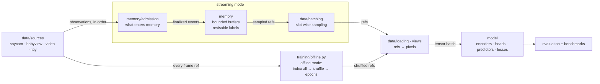
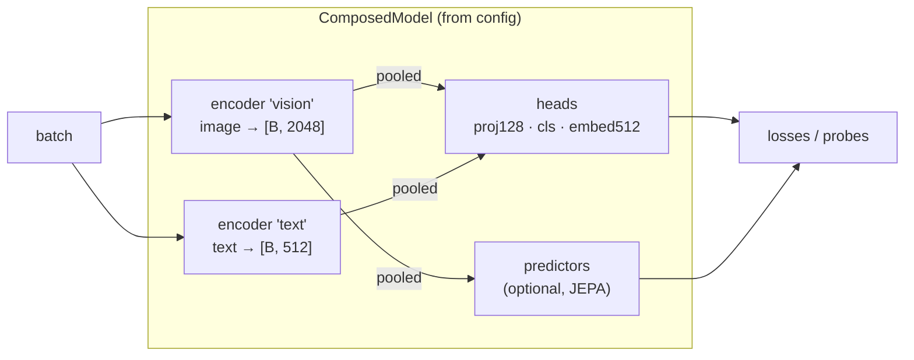

# Architecture

How the streaming framework fits together. Install and quickstart live in the
[README](../../README.md); design contracts that predate this implementation
are in [streaming.md](streaming.md).

The setting: a learner watches a long video stream exactly once, in
chronological order. It has to decide what to keep in a bounded memory, how
to build training batches out of that memory, and how much compute to spend
per unit of new data, and it gets evaluated continuously while it learns.

A method here is a config file. It picks components from the shared toolbox,
plus whatever novel algorithms it contributes itself. Two full paper
reproductions ship with the framework; building them is how the design was
checked against real methods:

* **Memory Storyboard** — streaming visual SSL with temporal segmentation
  and a two-tier memory (`src/egolearn/methods/storyboard/`)
* **BabyCL / BabyCLIP** — continual visual+verbal learning from SAYCam in a
  single chronological pass (`src/egolearn/methods/babycl/`)

Both are plain configs over the toolbox; their segmentation algorithms are
1:1 ports of the original published code.

Conventional offline IID training is also supported, as a parallel mode
rather than an afterthought: `driver.mode: offline` gives you the ordinary
shuffle-and-epochs loop with no memory machinery at all. It exists because
it's the upper bound every streaming method gets compared against.

## How it fits together



Not drawn: `training/driver.py` runs the streaming loop (pull new data from
the stream, store what admission emits, run k training steps, repeat), and
the optimizer setup, hooks and the timing report sit beside both loops.
Method-owned research code (the segmenters) plugs into the same admission
slot as the built-in components.

One streaming cycle, concretely. The driver pulls the next observations in
time order — a frame, or an utterance that just finished. At this point
everything is references and metadata; no pixels. Admission components watch
the stream and emit units that are final and will never change (a frame, a
~3-minute segment, an utterance–frame pair). Events get routed into memory
tables by schema; when a table is full, its update policy decides who stays.
To train, the composer follows the batch recipe and samples references from
memory ("3 segments × 32 frames + 32 utterance–frame pairs, 25% short / 75%
long"), and only then does the Loader decode and augment anything. Each loss
reads model features through named encoders/heads, the weighted sum
backpropagates, and after k gradient steps the driver goes back to the
stream. The run ends when the stream is exhausted — never at a precomputed
step count. Probes can score the model at any point along the way.

Offline mode skips all of that: list every frame up front (still just
references), shuffle once per epoch, draw batches, decode, train. The two
modes share the loader, augmentations, model, losses, solver and evaluation,
so a streaming-vs-IID comparison isolates the training regime rather than
accidental implementation differences.

Where code goes:

| Home | Rule of thumb | Contents |
|---|---|---|
| `src/egolearn/` | anything installable and tested | the five modules, plus `methods/<name>/` (one paper's novel components) and `evaluation/benchmarks/` (scoring, belongs to no method) |
| `projects/<name>/` | what you type to run a paper | configs composing on the packaged tree; thin entry points |
| `scripts/` | operations | Slurm launchers, benchmarks |

A config lists `_imports_:`; importing a methods module registers its
components. If a component turns into a de-facto standard it gets promoted
out of `methods/` without changing the name configs use for it. The bar the
design aims for: a method should be fully expressed by its config plus its
own `methods/` package. If a method has to patch the toolbox to work, some
interface is missing a piece.

## Core vocabulary

Three small types from `src/egolearn/core/` show up everywhere:

* `ItemRef` — a reference to a time interval on one channel of one session:
  `(session, channel, t0, t1, locator)`. A single frame is the point
  interval `t1 == t0`. Refs are cheap and immutable, and the Loader is the
  only place one becomes pixels. Whether a ref loads as one frame, K sampled
  frames, or a contiguous clip is the batch recipe's decision, not the
  ref's — the same stored record can be read either way.
* sample record — a plain dict whose keys are registered names (`time.t0`,
  `video.ref`, `text.utterance`, `weight.sample`, ...). Using a key that was
  never registered raises an error immediately, so a typo can't silently
  drop data. Components pass along keys they don't recognize, which is how
  e.g. a per-sample importance weight travels untouched from the dataset
  json all the way to the loss.
* event — a named schema (a required key set) for records entering memory:
  `RawFrame`, `VisualSegment`, `AlignedPair`. `build()` checks all of these
  contracts at construction time.

## The modules

### `egolearn.data`

`sources/` holds dataset adapters. A `Stream` is an ordered set of sessions;
a session exposes time-aligned channels, dense (video frames) and sparse
(utterances, narrations, annotations). Sparse items are surfaced at their
end time — a streaming learner never acts on an utterance it hasn't fully
heard. Alignment is always media time, never index. Ships with
`stream:saycam`, `stream:babyview`, `stream:packed_frames` (the same adapter
over a packed shard store, one read per frame or clip; see
[data_loading.md](../data_loading.md)), `stream:video` and `stream:toy`
(synthetic, with known ground truth).

`decoding/` is where video decode backends live. Baseline storage is
pre-extracted frames (`decoder:frame_dir`), per streaming.md; the
`VideoDecoder` protocol keeps the door open for on-the-fly decoding, with
sequential access (the streaming pass: open handle, read ahead) and random
access (replay: seek to keyframe, decode one window) as separately
optimizable paths. `decoder:poodle` is the stub for the lab's efficient
video pipeline; its docstring lists what the integration has to provide.

`loading.py` is the Loader, the only place refs become tensors. Decode and
augmentation — frames and clips alike, one submission per batch — can fan
out to worker processes (`loader.workers`); every item's randomness derives
from what the item is (the batch's sequence number, slot, position), so the
worker count is a throughput knob that never changes what a run computes.
On top of that, `driver.prefetch` composes the next batch while the current
one trains on the GPU — safe because sampling state only changes when the
stream advances, and a component that breaks that rule declares
`mutates_sampling_state`, which makes the build refuse to prefetch. It serves
every data unit — single frames, K frames sampled from a segment, pairs, and
contiguous clips — and its time shows up as `data.load` in the timing
report. `views.py` holds named augmentation pipelines (`center_crop`,
`simclr_strong`; method-tied recipes like `cvcl_aug` live in their methods
package) plus clip-domain views that draw parameters once per clip so all T
frames get the same crop/flip/jitter. `blur.py` holds the Gaussian blur
implementations the SimCLR-style views choose from (`blur_impl`).

`batching/` declares what a minibatch is. A recipe is a list of slots; each
slot names its source (a memory tier, a tier mix with fractions, or the
newest events), a unit (`frame`, `segment`, `pair`, `clip`), views, and
where labels come from. A recipe may carry a fallback — BabyCL uses this
early in the stream, when there aren't enough utterance pairs yet and the
batch becomes all-visual. The composer first checks that every slot can be
filled before decoding a single image (so a half-buildable batch never
wastes decode work), then loads and assembles the tensors. What happens to
a unit afterwards (which encoder, which loss) is the model side's business;
the loading layer just has to support the shape.

### `egolearn.memory`

Streaming-mode machinery, all of it. `table.py` has `Table` (capacity,
update policy, sampler; holds records with refs, never tensors) and
`TieredMemory`, supporting the two topologies the reproductions needed:
spill (new items enter the short buffer, and whatever the full short
buffer pushes out moves into the long one — BabyCL) and parallel (new items
enter both buffers independently — Memory Storyboard). `update.py` has the
standard update policies, i.e. what a full buffer does when a new item
arrives (`fifo`, `reservoir`, `reservoir_weighted`, `random_replace`);
research policies belong in methods packages.

`labels.py` is the LabelStore. Stored items don't carry labels — they carry
a key, and labels are resolved through the store at batch time. That way a
label can be revised long after the item entered memory (Memory Storyboard
reclusters and merges classes retroactively; BabyCL merges global ids when
two segments turn out to be the same thing). Stored items are never mutated.

`admission/` defines the `EventBuilder` protocol: online components that
watch the stream and decide what enters memory. Emitters produce finalized
events — emitted once, never changed. Labelers maintain a LabelStore. One
class can play both roles; the segmentation algorithms of both papers are
method-owned builders that do.

### `egolearn.model`

A model is a composition declared in the config, not one backbone class.
The parts, one line each:

* **encoder** — one modality's tensor in, a representation out. An encoder
  declares its modality (`image`, `video`, `text`) and its output width;
  everything else addresses it by the name the config gave it. Shipped:
  `resnext50`, `resnet18`, `toy_cnn` (image), `video_vit` (V-JEPA 2's design:
  tubelet embedding, 3D rotary positions, and an optional visible-token
  forward for masked prediction) and `toy_video` (video); BabyCL's
  bag-of-words text encoder lives in its method package.
* **encoder output** — what `encode()` returns is a wrapper, not a bare
  tensor: `pooled` (always, `[B, D]`), plus optional `tokens` (a ViT's patch
  sequence, for token-space prediction and masking), `spatial` (the feature
  map before pooling, for dense heads and attribution maps) and an `aux`
  dict. Consumers name the field they read, so an encoder that starts
  returning tokens changes no signature and breaks nobody.
* **head** — a small module (projector, classifier); names the encoder it
  sits on and consumes its pooled output.
* **predictor** — representation(s) in, predicted representation out; the
  JEPA-style component. Names the encoders it reads. Shipped: `mlp` and
  `vjepa` (a narrow transformer that fills mask tokens in at target
  positions).
* **generative component** — interface reserved (`generate` / `score`),
  nothing built yet.
* **loss** — consumes representations by slot and head name: `ntxent`
  (accepts several slots and concatenates — MS computes it over
  current+replay jointly), `tcl` (segment-label cross-entropy with optional
  masking of unseen classes), `clip_infonce` (symmetric image–text InfoNCE,
  optional per-sample weights), `vjepa` (masked prediction in representation
  space: multiblock masks on the token grid, a frozen EMA-target encoder
  updated in `on_step_end`, L1 to its tokens at the masked positions). A
  loss that runs its own encoder forwards, as `vjepa` does, declares
  `own_forward`; the drivers then skip the shared pooled precompute for its
  slots instead of computing features nobody reads.



The composed model exposes everything by name — `encode(name, x)`,
`apply_head(name, feats)`, `predict(name, reps)` — and derives a set of
**capabilities** from its parts (`image_representation`,
`video_representation`, `text_representation`, `multimodal`, `prediction`,
`generation` reserved). Two things hang off that:

* **Config swapping.** `resnext50` → a ViT, image encoder → video encoder,
  one text encoder → another: each is one line in `model.encoders:`, because
  every batch slot carries the modality its spec declares, the model routes
  each slot to the encoder of that modality, and losses read representations
  by name, never by class.
* **Model ↔ evaluation compatibility.** A probe declares
  `requires_capabilities`; `build()` compares that against the model's set.
  An image–text retrieval probe wired against a vision-only model fails at
  startup with one message, so model × evaluation pairs need no adapters.

Every checkpoint records the full name→role mapping (encoders and their
modalities, heads, predictors, capabilities), so a trained encoder
reloads elsewhere by name.

Design check against the model families beyond the founding reproductions
(the point was to make sure none of them is blocked):

| model family | as a composition |
|---|---|
| CLIP-style dual encoder | `encoders: {vision, text}` + heads into a shared space + `clip_infonce` — this is BabyCL's cross-modal half, already running |
| V-JEPA | **shipped**: `video_vit` + a second frozen copy (`frozen: true` — carried in snapshots, kept in eval mode, excluded from the optimizer and from modality routing) + `predictor:vjepa` + `loss:vjepa`; trains on clip slots in the streaming loop and on `unit: clip` batches in the offline loop, with the same determinism guarantees (same seed = same weights, resumed = uninterrupted, EMA target included) |
| masked video modeling (VideoMAE-class) | the same sockets V-JEPA uses: mask samplers on the token grid (`model/masking.py`), the encoder's visible-token forward and `tokens` output; what's left to add is the pixel decoder and reconstruction loss |
| language-conditioned JEPA | `predictor:vjepa` with a second input (`inputs: [video, text]`) — conditioning enters as extra tokens |
| autoregressive / generative | registers as a `generative` component; the capability name and eval hook exist, the module does not |
| attribution / dense evals (GradCAM-class) | read the output's `spatial` field; adding it to an encoder breaks no pooled consumer |

### `egolearn.training`

`driver.py` is the streaming loop, kept deliberately small. Pull a chunk of
new data from the stream (a fixed number of observations — MS uses 64
frames — or until something specific appears — BabyCL waits for 1 finished
segment), store what admission emits, then run `steps_per_admit` training
steps. This ratio fixes how much training happens per unit of new data,
which is what makes compute-matched comparisons a config knob. With
`resample: true` each step composes a fresh batch (BabyCL's
repeats_per_push); with `false` the same batch is reused (MS's num_grads).
Warmup is an admit-only phase until a buffer tier fills. If a method needs a
different loop, subclass the driver.

`offline.py` is the IID counterpart: index, shuffle per epoch, train.
Declaring memory/admission/recipe sections in an offline config is a
validation error, on purpose.

`solver.py` maps regex-matched parameter groups to (lr, weight decay), with
optional BN/bias decay exemption. The LR schedule has no epochs: it runs off
progress, meaning the fraction of the stream consumed so far. It starts
counting at the first training step rather than at the start of buffer
filling, so filling the buffers doesn't eat into the LR warmup.

`profiling.py` is the `StageTimer`: every run times each stage
(`stream.advance`, `data.load`, `batch.compose`, `model.forward`,
`model.backward`, `optim.step`) and prints the breakdown, so it's always
visible where a run actually spends its time. `scripts/bench/` runs the
same measurement standalone: `bench_full_pipeline.py` over real training
steps, `bench_dataloading.py` over data loading alone. For calibration: the
original BabyCL holds roughly 70% GPU utilization on 2×A100, and a port
should be compared against that before merging. Current single-thread
measurements (one L40S, 2026-08): stream ingest runs at ~700× realtime and
is nowhere near the bottleneck; batch composition takes ~1.4 s (about 80% of
it in the ms-view Gaussian blur), capping a single-threaded run at ~0.7
steps/s. The fix, both halves now in: the decision-making stays serial
(which refs to sample, where a clip starts), the decode+augment work spreads
over a worker pool (`loader.workers`), and the whole compose overlaps the
GPU step (`driver.prefetch`). Measured on the BabyCL reproduction run (one
A100): composition 2.6 s → 0.56 s per batch, ~4× end to end.

Resume works in both modes: pass `resume=auto` (or a snapshot path) to the
train entry point. A snapshot holds everything a run needs to continue —
model, optimizer, clocks and RNG states (named and global), memory tables, label stores, the
LR schedule's reference point. On restore,
streaming mode replays the already-consumed stream deterministically to
rebuild the admission components' internal state (replayed events don't
touch memory; that comes from the snapshot). Offline mode regenerates the
epoch shuffle from (seed, epoch) and picks up mid-epoch.

### `egolearn.evaluation` and `evaluation/benchmarks/`

A `Benchmark` is `prepare()` plus `run(model, ctx) → {metric: value}` and
runs independently of training through `evaluate` or `evaluate_checkpoint`.
`Probe` extends that contract for evaluations scheduled at a gradient-step
cadence; existing probes also work in the standalone runner. ImageNet is
benchmark-only. Model reconstruction is shared with training and reads resolved
construction metadata from new checkpoints, or an explicit config for old ones.
See [the evaluation guide](../evaluation.md) for the API and CLI.
Each concrete benchmark owns a package under
`src/egolearn/evaluation/benchmarks/`, ported 1:1 from the original eval scripts:

| Benchmark | Protocol | Metric |
|---|---|---|
| `labeled_s_4afc` | target word vs 4 candidate images, argmax cosine | `four_afc_acc` |
| `labeled_s_linear` | frozen-split 26-class fixed-feature L-BFGS linear decoding | `top1`, `train_top1` |
| `babyview_4afc` | Labeled-S 4AFC protocol on BabyView crops; frozen-split 72-class linear probe | `four_afc_acc`; `top1`, `train_top1` |
| `imagenet_linear` | full ImageNet ImageFolder train/val; frozen encoder + stochastic-view SGD/LARC linear decoder, 224px by default | `top1`, `train_top1_running` |
| `vtwt` | one image, two 2-word phrases; the positive must strictly win | `vtwt_acc` |
| `baby_winoground` | 2×2 image/phrase matrix; group-correct iff both directions hold | `bw_group_acc` + per-context accs |
| `shape_bias` | novel shape/texture triplets, cosine preference | `shape_bias` |
| `intphys2` | possible vs impossible video pairs; V-JEPA prediction error, 64 uniform frames, contexts 2-16 | `voe_acc` + per-context `voe_acc_ctx<C>`, `voe_auroc` |
| `grasp` | GRASP Level 2 plausible vs implausible twins on the same VoE readout, from a prepared pair manifest | `voe_acc`, `voe_auroc`, per-context `voe_acc_ctx<C>`, per-test and per-concept `voe_acc_<group>`/`voe_auroc_<group>` |

Some quirks of the originals are preserved on purpose (OOV words map to
padding index 0 and still count in the mean-pool denominator; no sos/eos;
32-token truncation), since OOV handling is part of what these benchmarks
measure. `probe:linear` uses fixed-feature L-BFGS: it caches features from one
deterministic view and solves a standardized logistic regression with full-batch
L-BFGS. `probe:linear_sgd` (`LinearSGDProbe`) uses stochastic-view SGD: it trains
an L2-normalized linear head with SGD, LARC, and cosine decay for 10 epochs,
recomputing features from stochastic crops through the frozen encoder. Its
default input size is 112px; the fixed-feature probe and full ImageNet adapter
(`ImageNetLinearBenchmark`) default to 224px. Evaluation defaults to
`imagenet_center_crop` for the SGD probe (bilinear resize to `256 * size // 224`,
then center crop) and `center_crop` for the fixed-feature probe (bicubic resize
to `size`, then center crop). Match `view` and `size` across probes to align
evaluation inputs. The SGD probe's `seed` controls decoder initialization,
shuffling, augmentations, and worker seeding independently of the run seed;
changing the worker count preserves sample order and augmented inputs.

### Configs: hydra outside, registries inside

The split of labor: **hydra owns how YAML becomes one config dict** —
defaults lists, config selection through `egl train`, CLI overrides
(`seed=42 driver.rate.steps_per_admit=4`), multirun, and writing every run's
resolved config to `.hydra/config.yaml` (the reproduction truth). **The
registries own how that dict becomes objects**: `_target_: "kind:name"`
resolves through per-kind registries (`stream`, `decoder`, `view`,
`admission`, `update`, `sampler`, `embedder`, `encoder`, `head`, `predictor`, `loss`,
`probe`), nested nodes instantiate recursively, `_imports_:` pulls in
methods/benchmark modules.

The registry layer buys three things hydra's bare `_target_` doesn't: short
names decoupled from code location (promoting a component out of `methods/`
changes no config), kind checking (a view pasted into an admission slot
fails with a one-line error), and self-registration of method components on
import. No logic in configs — YAML describes an object graph and scalar
hyperparameters, nothing else.

Project configs compose the packaged tree per the repo convention:

```yaml
defaults:
  - /config          # packaged root: seed, wandb, dry_run, resume
  - _self_
hydra:
  searchpath:
    - pkg://egolearn.configs
```

## Streaming vs offline, side by side

| | `mode: streaming` | `mode: offline` |
|---|---|---|
| loop | pull stream data → store admitted items → k training steps | shuffle → epochs |
| data access | sequential, in order (+ random for replay) | random/shuffled |
| memory / admission | bounded tiers, update policies, event builders | none |
| progress clock | fraction of stream consumed | fraction of planned steps |
| epochs | never | conventional |

See `src/egolearn/configs/offline_iid_saycam.yaml` for an offline example:

```bash
uv run egl train offline_iid_saycam \
    stream.root_dir=$DATA_ROOT
```

## The two reproductions

`methods/storyboard/` carries Memory Storyboard's contributions:
`greedy_hierarchical_clustering` and `get_cluster_score` verbatim from the
public repo (including the quirk of forcing K−1 cuts even when the score
drops), the recluster-on-window-turnover admission builder with retroactive
relabeling through the LabelStore, and `embedder:learner` (MS segments
with the learner's own backbone).

`methods/babycl/` carries BabyCL's: the segmentation math from
`online_ms_refine.py` verbatim, the OnlineSegmenter (sliding window,
utterance-anchored expansion, ~3-minute packing, watermark finalize-once,
global-id merge with cross-session handover), the multimodal admission path
(raw timestamp runs, atomic complete-visibility emission, dedup — and no
similarity expansion, because the original feeder discards the segmenter's
expanded chunks), the frozen ResNeXt embedder, the bag-of-words text encoder,
and both augmentation recipes (`cvcl_aug` with the original's PIL radius
blur; `babycl_ms_aug`, which fuses the original's two-stage center-crop-then
-strong-SimCLR segment augmentation into one pipeline).

Where the two methods differ is easiest to see side by side:

| Mechanism | Memory Storyboard | BabyCL |
|---|---|---|
| memory unit | frame refs (short admits every 8th) | segment refs + pair refs |
| admission topology | parallel: new → short and long | spill: new → short, overflow → long |
| batch | slot(short)=64 + slot(long)=448 | 3 segs×32 + 32 pairs, tiers split by the `want//4` rule |
| segmentation | recluster window, retroactive relabel | watermark finalize-once, utterance-anchored expansion |
| segmentation embeddings | learner's own backbone | frozen ImageNet ResNeXt |
| labels | global ids, revised on recluster/merge | batch-local for TCL, write-once gids |
| rate limiter | same batch × num_grads (`resample: false`) | fresh batch × 8 (`resample: true`) |
| losses | 1.0·ntxent(curr+replay) + 1.0·tcl(replay) | 0.5·ntxent + 0.5·tcl + 0.5·clip_infonce |

Framework adaptations are documented in each component's docstring; the
algorithms themselves are untouched (ruff exempts the verbatim files so
their original style survives). Published BabyCL ablations are config
diffs — see `projects/babycl/README.md`.

## Design rules

A few rules the codebase follows consistently:

* The Loader is the only place a reference turns into pixels. Storage and
  sampling — memory tables, routing, batch draws — handle references and
  small metadata only, which is what keeps buffers cheap and makes
  on-the-fly video decoding a swappable backend (and generative memory "a
  Loader that synthesizes"). Admission components are the exception that
  proves the rule: when an algorithm needs to look at image content, it
  pulls frames through that same Loader (see `EmbeddingProvider`), so there
  is still exactly one decode path.
* Events are emitted once and never change; labels are revisable through the
  LabelStore. That split is exactly what both published systems need.
* The streaming loop has no epochs and no task ids — everything is indexed
  by time (media time inside records, stream progress and step count for
  schedules). The offline loop has conventional epochs, which is the point
  of it being the traditional baseline.
* All framework randomness is named and seeded
  (`ctx.rng("memory.pairs.short")`), and the Context also seeds the global
  torch/python RNGs (weight init and torchvision augmentations draw from
  those) and carries their state through snapshots — so the same seed gives
  bit-identical weights, and a resumed run matches an uninterrupted one.
  Both guarantees are tested at weight level in `tests/test_core.py`.
* Every run prints its per-stage timing, and merges get validated by real
  experiments. When the timing shows some abstraction is the bottleneck, the
  fix is a faster implementation behind the same interface (native decode,
  hot paths in C++), not living with it.
* V1 is single-process and deterministic: one fixed loop, no background
  threads. Parallel data loading, DDP and other concurrency are deferred on
  purpose; the interfaces keep those doors open.

## Extending

* New method: a `src/egolearn/methods/<name>/` package (components,
  registered on import) plus a `projects/<name>/` directory (configs, entry
  points).
* New dataset: a source adapter in `src/egolearn/data/sources/`. Ego4D
  narrations are structurally SAYCam utterances, so `an_chunk_emitter`
  transfers unchanged.
* New video backend: implement `VideoDecoder` (the Poodle integration is
  exactly this).
* New modality (audio, gaze, boxes, precomputed embeddings): register its
  keys and put the values in a channel payload; if it needs decoding, add a
  method to the Loader next to `frame_views`; if it must co-transform with
  crops (gaze, boxes), extend the view signature — views already receive the
  whole record for this reason.
* New benchmark: a package under `src/egolearn/evaluation/benchmarks/`
  owning its benchmark and any training probe adapter.
* New loop behavior: subclass `LockstepDriver`.

## File guide

Mode column: shared = both training modes, streaming/IID = that mode only,
method = one paper's research code, eval = benchmark code.

| File | Mode | What it is |
|---|---|---|
| `src/egolearn/train.py` | shared | hydra entry point: compose config → `build()` → `validate()` (`dry_run=true` stops here) → optional `resume=` → `fit()` |
| `src/egolearn/pipeline.py` | shared | reads the composed config, builds the streaming or offline pipeline, validates every contract before any data is read |
| `src/egolearn/configs/` | shared | packaged hydra tree: root config (seed, wandb, dry_run, resume) + the offline IID example |
| `src/egolearn/core/keys.py` | shared | the key registry; every dict between modules uses keys registered here, typos fail at first use |
| `src/egolearn/core/refs.py` | shared | `ItemRef` — the lightweight reference passed around everywhere instead of actual pixels |
| `src/egolearn/core/events.py` | shared | event schemas (`RawFrame`, `VisualSegment`, `AlignedPair`) |
| `src/egolearn/core/context.py` | shared | run context: progress/step clocks and named, seeded RNGs |
| `src/egolearn/config/registry.py` | shared | per-kind component registries; configs address anything as `"kind:name"` |
| `src/egolearn/config/instantiate.py` | shared | recursive `_target_` instantiation + the plain single-file config loader |
| `src/egolearn/data/sources/base.py` | shared | Stream/Session/Channel protocols; sparse items surface at their end time |
| `src/egolearn/data/sources/saycam.py` | shared | SAYCam + BabyView adapters (frame dirs + the CVCL transcript json) |
| `src/egolearn/data/sources/packed.py` | shared | the same adapter over a packed frame store: same refs, one read per frame or clip |
| `src/egolearn/data/sources/video.py` | shared | video-first source: raw video files + a pluggable decoder |
| `src/egolearn/data/sources/toy.py` | shared | synthetic stream with known ground truth |
| `src/egolearn/data/decoding/base.py` | shared | `VideoDecoder` protocol, sequential vs random access |
| `src/egolearn/data/decoding/frame_dir.py` | shared | extracted-frames directory viewed as a decode backend |
| `src/egolearn/data/decoding/poodle.py` | shared | integration stub for the lab's video pipeline |
| `src/egolearn/data/loading.py` | shared | the Loader — the only place refs become tensors; all units (frame/segment/pair/clip) |
| `src/egolearn/data/views.py` | shared | named augmentation pipelines + clip-consistent views |
| `src/egolearn/data/blur.py` | shared | Gaussian blur implementations for the image views (separable default, reference, none) |
| `src/egolearn/data/packed/` | shared | packed frame store: shard files + numpy index; `python -m egolearn.data.packed` builds and verifies |
| `src/egolearn/data/text.py` | shared | CVCL-style vocab tokenizer |
| `src/egolearn/data/batching/recipe.py` | streaming | slot/recipe declaration, incl. the fallback recipe |
| `src/egolearn/data/batching/composer.py` | streaming | fills slots: draw all refs first, then load, tokenize, resolve labels, collate |
| `src/egolearn/memory/table.py` | streaming | `Table` + `TieredMemory` (spill and parallel topologies) |
| `src/egolearn/memory/update.py` | streaming | update policies: fifo, reservoir, weighted reservoir, random replace |
| `src/egolearn/memory/labels.py` | streaming | the LabelStore — batch-time label resolution, revisable |
| `src/egolearn/memory/admission/base.py` | streaming | `EventBuilder` + `EmbeddingProvider` protocols |
| `src/egolearn/memory/admission/frame_emitter.py` | streaming | every (subsampled) frame becomes a `RawFrame` event |
| `src/egolearn/memory/admission/fixed_window.py` | streaming | fixed-window labeler (MS's prior labels / trivial chunking baseline) |
| `src/egolearn/model/model.py` | shared | `ComposedModel`: named encoders + heads + predictors; capabilities; export contract |
| `src/egolearn/model/encoders/` | shared | encoder contract (base.py) + image encoders (resnext50, resnet18, toy_cnn) + video (toy_video) |
| `src/egolearn/model/predictors.py` | shared | predictor contract + `predictor:mlp` |
| `src/egolearn/model/generative.py` | shared | reserved generative/autoregressive interface |
| `src/egolearn/model/heads.py` | shared | linear, mlp |
| `src/egolearn/model/losses/` | shared | loss protocol + ntxent, tcl, clip_infonce |
| `src/egolearn/training/driver.py` | streaming | the streaming loop: pull stream data → store admitted items → k training steps |
| `src/egolearn/training/offline.py` | IID | index → shuffle per epoch → train |
| `src/egolearn/training/solver.py` | shared | regex param groups, progress-clock cosine schedule |
| `src/egolearn/training/hooks.py` | shared | logging, checkpoints, probes, snapshots, wandb |
| `src/egolearn/training/profiling.py` | shared | the per-stage timing report |
| `src/egolearn/utils/snapshot.py` | shared | save/restore the whole world; streaming resume replays the stream |
| `src/egolearn/evaluation/benchmark.py` | shared | the standalone `Benchmark` contract |
| `src/egolearn/evaluation/evaluator.py` | shared | benchmark execution and structured results |
| `src/egolearn/evaluation/checkpoint.py` | shared | model-only checkpoint loading and evaluation |
| `src/egolearn/evaluation/probe.py` | shared | the training `Probe` contract |
| `src/egolearn/evaluation/benchmarks/` | eval | 4AFC, linear decoding, visual two-word test, Baby Winoground, shape-bias, IntPhys 2, GRASP probes |
| `src/egolearn/methods/storyboard/` | method | verbatim clustering + recluster admission + learner embedder |
| `src/egolearn/methods/babycl/refine.py` | method | verbatim segmentation math from `online_ms_refine.py` |
| `src/egolearn/methods/babycl/segmenter.py` | method | the OnlineSegmenter, 1:1 |
| `src/egolearn/methods/babycl/an_chunks.py` | method | the multimodal admission path, 1:1 |
| `src/egolearn/methods/babycl/data.py` | method | `cvcl_aug`, `babycl_ms_aug`, frozen ResNeXt embedder |
| `src/egolearn/methods/babycl/model.py` | method | the CVCL bag-of-words text encoder |
| `projects/babycl/configs/saycam_default.yaml` | method | the paper's default run as config |
| `projects/storyboard/configs/saycam.yaml` | method | the MS reproduction as config |
| `scripts/slurm/` | ops | cluster-independent sbatch templates + minimal cluster setup docs |
| `scripts/bench/` | ops | data-plane and full-pipeline benchmarks |
