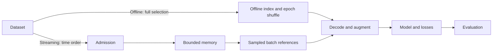

# Architecture

EgoLearn separates the data a learner has seen from the data it uses for each
training update. This lets streaming methods compare memory and sampling policies
while sharing models, augmentation, optimization, and evaluation.

[BabyCL](../../projects/babycl/README.md) and
[Memory Storyboard](../../projects/storyboard/README.md) select these components
through configuration files. Their segmentation algorithms live in method packages,
while the training framework provides the common machinery. The
[historical design notes](streaming.md) explain the original constraints.

## Training flow

A streaming learner reads observations in time order and retains a bounded subset
for training. Its memory resembles a reading list: entries identify material to
revisit, while the underlying frames remain in the dataset.

Each streaming cycle advances through new observations, admits completed items to
memory, and runs the configured number of training updates. Admission can retain
individual frames, completed visual segments, or utterance–frame pairs. An utterance
becomes visible at its end time, so the learner cannot use words it has not heard.

The batch recipe samples references from memory, and the loader decodes and augments
the selected frames. Losses read the resulting model representations and contribute
to the weighted training objective. Admission algorithms that inspect image content
also use the loader, so segmentation can decode frames before batch sampling.

A streaming run normally ends when its input is exhausted, though `driver.max_steps`
can stop it earlier at a check between stream advances. One advance
may schedule several training updates, so this is not an exact per-update cutoff.

## Streaming and offline training

Offline training makes the selected dataset available from the start and shuffles
it across epochs, allowing comparisons where the learner can revisit the whole
dataset without a bounded replay memory.

| Property | Streaming | Offline |
| --- | --- | --- |
| New data | Chronological observations | Complete selected dataset |
| Training samples | Current observations and retained memory | Shuffled dataset or method-specific offline index |
| Memory policy | Bounded buffers and admission rules | No streaming memory or admission |
| Progress | Fraction of stream consumed | Fraction of planned steps |
| Repetition | Updates per stream advance | Epochs |

Set `driver.mode: offline` for the generic IID loop. Its configuration rejects
streaming memory, admission, routing, and batch-recipe sections. The
[offline SAYCam config](../../src/egolearn/configs/offline_iid_saycam.yaml) gives a
complete example. BabyCL also has an
[offline mixed-objective variant](../../projects/babycl/docs/offline.md), whose
utterance index and precomputed segments define its batches.

The modes share data loading, model components, losses, and evaluation, but a comparison
still needs matched datasets, augmentations, objectives, and compute budgets.
Changing the training mode alone does not establish an equivalent experiment.

## References and records

Memory stores references and small metadata rather than decoded tensors. This keeps
buffer capacity independent of image resolution and allows each replay to draw
fresh augmentations.

An `ItemRef` identifies a time interval on one channel of one session, with equal
start and end times for a single frame. A batch recipe decides whether to load one
frame, several sampled frames, or a contiguous clip from that interval.

Records carry registered fields such as a video reference, an utterance, or a sample
weight. Event schemas specify the fields required for items entering memory. Pipeline
construction checks component contracts, and record validation rejects unknown keys.

## Training components

### Data and batches

Dataset adapters expose ordered sessions with video and text channels aligned by
media time rather than frame indices. Frame-directory, packed-frame, and synthetic
sources use the same stream interface. A raw-video training adapter exists, but its
decoder backend is a stub; use extracted or packed frames for training.

A batch recipe declares slots with their sources, sample counts, units, views, and
label stores. Sources can select a memory tier, mix several tiers, or use newly
admitted items, with slot availability checked before decoding images.
A fallback recipe handles temporary shortages, such as BabyCL's early all-visual
batches before enough utterance pairs become available.

Views define image augmentation or clip augmentation with parameters shared across
frames, while method-specific views preserve the preprocessing used by that method. See
[data loading](../data_loading.md) for packed storage and numerical blur controls.

### Memory and labels

A memory tier combines a capacity, an update policy, and a sampling policy. The
update policy decides which records survive when new items arrive, while sampling
chooses which retained records contribute to a training batch.

BabyCL uses spill routing: records enter a short buffer, and evicted records move
into a long buffer. Memory Storyboard admits records to both tiers independently.
Available update policies include FIFO, reservoir sampling, weighted reservoir
sampling, and random replacement.

Labels can change without replacing stored frame references because a `LabelStore`
resolves them when a batch is assembled. This allows Memory Storyboard to revise classes
after reclustering. Loader workers decode images without maintaining a shared copy
of those labels. Emitted event records remain fixed.

### Models and objectives

A model combines named encoders, heads, and predictors, each selected through its
configuration. An encoder consumes one modality and returns a pooled representation,
with optional token or spatial outputs.
Heads transform encoder representations, while predictors estimate representations
from their inputs.

Batch slots route by modality, so each modality has at most one trainable encoder.
Additional copies, such as EMA targets, must be configured with `frozen: true`.

Losses name the batch slots and model components they use, allowing several objectives
to share representations. Memory Storyboard combines instance discrimination with
temporal classification, while BabyCL adds an image–text contrastive objective.
V-JEPA predicts masked video representations using a context
encoder, a predictor, and a frozen target encoder updated by an exponential average.
Its components are `encoder:video_vit`, `predictor:vjepa`, and `loss:vjepa`, with
`unit: clip` slots and the `clip_rrc` view. No packaged V-JEPA training config ships;
the [video tests](../../tests/test_video.py) contain a complete small composition.

Model capabilities describe the available representations and prediction interfaces,
which evaluation components check against their declared requirements during construction.
Checkpoints retain model construction metadata so evaluation
can rebuild the named components without creating a training pipeline.

### Training and concurrency

`driver.advance` defines an advance as a count of observations or finalized events.
Storyboard advances by 64 frames, while BabyCL advances by one completed segment.
`driver.rate.steps_per_admit` sets the number of updates, while
`driver.rate.resample` chooses fresh batches or reuse within that advance. Buffer
warmup admits data before training begins.

`loader.workers` enables worker processes for decoding and augmentation, while
`driver.prefetch` uses a background thread to prepare the next batch during training.
Prefetch requires `loader.workers >= 1`. In streaming mode, it takes effect only
with `driver.rate.resample: true` and `driver.rate.steps_per_admit > 1`.
It overlaps fresh batches within one advance, without crossing a change in stream
or memory state.

Components that change sampling state between updates declare
`mutates_sampling_state`, which prevents incompatible prefetch configurations.
Batch and item seeds preserve sample choices and augmentations across supported
worker and prefetch settings. Reproducibility tests compare uninterrupted and resumed
runs under the same configuration and execution environment.

Optimization can use a constant learning rate or a progress-based cosine schedule.
By default, the latter anchors warmup at the first training update rather than at
buffer filling. Stage timing reports distinguish stream advancement, batch assembly,
loading, forward/backward passes, and optimizer steps.

### Evaluation

Benchmarks score a model independently of training, while small evaluations can also
run as probes at configured training intervals using the same scoring implementation.
Full ImageNet decoding runs through the standalone evaluator.

The [evaluation guide](../evaluation.md) covers checkpoint loading, commands, and
benchmark metrics. Dedicated pages describe the spatial-relations and IntPhys 2
protocols and their comparison limits. Matching a model's capabilities does not ensure that
its preprocessing and evaluation protocol match a published result.

## Checkpoints and continuation

A model checkpoint contains weights and construction metadata for evaluation.
A full snapshot additionally records the optimizer, clocks, random states, memory,
labels, and schedule state needed to continue training.

Snapshot restoration in streaming mode replays consumed observations to rebuild
admission state, then uses the saved memory state. Generic offline restoration
recreates the epoch shuffle and continues at the saved position.

Use `resume` to continue a run, or [initialization](../initialization.md) to copy
selected weights into a fresh run. These operations are mutually exclusive.
For cluster continuation, follow the
[persistent run-directory instructions](../cluster.md#snapshots-and-records).

## Configuration

Hydra composes YAML defaults, applies command-line overrides, and writes the resolved
configuration for a run. Component registries then turn the configuration into
objects, resolving names such as `encoder:resnext50` within the expected component
kind.

A configuration's `_imports_` list loads method and benchmark registrations, letting
a method provide its own components while using the same training entry point.
Project configs inherit packaged defaults through Hydra's search path. See
[configuration and overrides](../cli.md#configuration-and-overrides) for selection
rules and examples.

## Method differences

The two methods use different memory units and segmentation signals within the same
streaming framework. Their project pages describe the objectives and available
configurations.

| Choice | Memory Storyboard | BabyCL |
| --- | --- | --- |
| Memory unit | Frames | Visual segments and utterance–frame pairs |
| Tier routing | Independent admission to short and long tiers | Short-tier overflow into long tier |
| Segmentation features | Learner's current backbone | Frozen ImageNet ResNeXt |
| Labels for temporal classification | Revisable global classes | Batch-local segment classes |
| Repeated updates | Reuse the batch | Resample each batch |
| Objective | Instance discrimination and temporal classification | Those objectives plus image–text contrastive learning |

## Design constraints

Retention and sampling operate on references, keeping decoded images out of replay
memory. Finalized event records are separate from revisable labels, so a label update
does not require rewriting buffers or synchronizing loader workers.

Streaming decisions remain ordered, while worker processes and prefetch parallelize
data preparation. The current training loops do not implement distributed data-parallel
training. Experiments that need different scheduling or memory semantics must provide
those components explicitly.

## Extension points

New methods belong under `src/egolearn/methods/<name>/`, with experiment
configs under `projects/<name>/`. Shared components belong in the library once
multiple methods need them. See [project conventions](../../projects/README.md).

| Extension | Starting point |
| --- | --- |
| Dataset adapter | [Stream and channel interfaces](../../src/egolearn/data/sources/base.py) |
| Admission algorithm | [Event builder interfaces](../../src/egolearn/memory/admission/base.py) |
| Memory retention | [Update policies](../../src/egolearn/memory/update.py) |
| Encoder | [Encoder interface](../../src/egolearn/model/encoders/base.py) |
| Objective | [Loss interface](../../src/egolearn/model/losses/base.py) |
| Augmentation | [Registered views](../../src/egolearn/data/views.py) |
| Training loop | [Streaming driver](../../src/egolearn/training/driver.py) |
| Evaluation | [Benchmark development](../evaluation.md#adding-benchmarks) |

Each extension needs behavior tests for its contract. Preserve deterministic ordering,
resume behavior, and evaluation protocols when adding a method or optimizing its
implementation.
